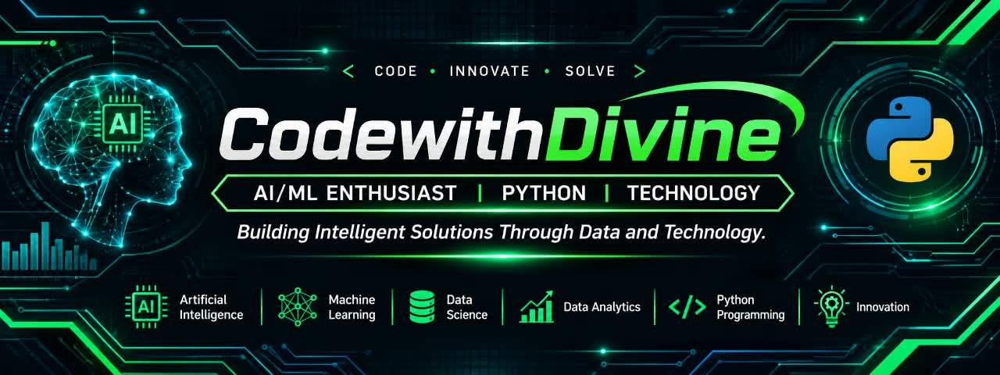

 

---

# Hi, I'm CodewithDivine 👋

### AI/ML & Data Science Enthusiast | Python | Technology

I'm passionate about using technology, data, and intelligent systems to understand problems and build practical solutions. My interests include Artificial Intelligence, Machine Learning, Python programming, Data Science, and the growing role of technology in healthcare.

## 👩‍💻 About Me

- Exploring Artificial Intelligence and Machine Learning through practical learning and hands-on exercises.
- Building my Python programming and problem-solving skills.
- Interested in discovering patterns in data and using them to support better predictions and decisions.
- Exploring Data Science, Data Analytics, and intelligent technology solutions.
- Interested in the intersection of healthcare and technology, bringing a healthcare background and a technology-focused mindset together.
- Committed to continuous learning, building, and improving through real-world practice.

## 🧠 AI, Machine Learning & Data Science

My areas of interest and practical exploration include:

- Artificial Intelligence (AI)
- Machine Learning (ML)
- Supervised Learning
- Regression and Classification
- Linear Regression
- Decision Trees
- Multiclass Classification
- Model Evaluation
- Data Cleaning and Preprocessing
- Feature Engineering
- Exploratory Data Analysis (EDA)
- Predictive Modelling
- Data Science and Data Analytics fundamentals

## 🛠️ Tools & Technologies

 

## 📚 Currently Learning

- Python programming and practical problem-solving
- Artificial Intelligence and Machine Learning concepts
- Data Science and Data Analytics
- Regression and classification techniques
- Model evaluation and validation
- Data cleaning and preprocessing
- Feature engineering
- Applying machine learning concepts through practical exercises and projects

## 💻 Hands-On Learning & Practice

Some of the concepts and exercises I have explored include:

- Linear regression and house-price prediction
- Mean Absolute Error (MAE) and Root Mean Squared Error (RMSE)
- Training and testing data with train-test split
- Understanding overfitting and underfitting
- Decision tree models and model validation
- Feature engineering
- Handling missing values and basic data cleaning
- Detecting duplicate records
- Understanding data leakage
- Classification and confusion matrices
- Multiclass classification

## 🚀 Featured Projects

I'm building my project portfolio as I continue to develop my skills. This section will grow as I publish projects and practical work.

- *Machine Learning Projects* — practical experiments with prediction and classification.
- *Data Analysis Projects* — exploring datasets, identifying patterns, and communicating insights.
- *Python Projects* — small programs and exercises that strengthen my programming skills.
- *Healthcare Technology* — exploring how data and intelligent systems can support healthcare solutions.

> Project links will be added here as they are published.

## 📊 GitHub Statistics

 

## 🌱 Professional Philosophy

I believe growth comes from staying curious, learning consistently, applying knowledge, and being willing to improve. My approach is:

*Learn → Build → Innovate → Share → Grow*

I'm interested in creating practical, data-driven solutions and contributing meaningfully to the technology community.

## 🤝 Connect With Me

- *LinkedIn:* [divine-austin](https://www.linkedin.com/in/divine-austin-6a0299394)
- *Email:* [vinesdesk@gmail.com](mailto:vinesdesk@gmail.com)

---

### Thanks for visiting my profile! ✨

Building knowledge, exploring possibilities, and growing through technology.

